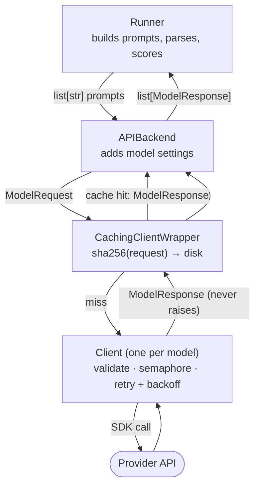
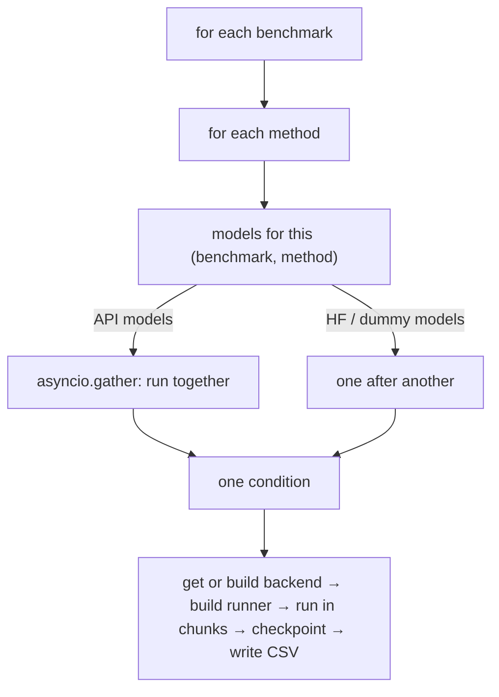

# How ChoiceBench works

This page explains the moving parts in the order a request travels through them, and *why* the code is split the way it is. The README's [Architecture](../README.md#architecture) section is the directory map; this is the mental model.

## 1. Three things vary independently

| Question | Varies by | Lives in |
|---|---|---|
| What do I ask, and how do I score the answer? | the **method** (direct MCQ, cyclic permutation, two-stage, …) | `methods/` (runners) |
| How do I get text or logprobs out of one model? | API, local HuggingFace, dummy | `backends/` |
| Which provider's API do I speak? | OpenAI, Anthropic, Groq, vLLM, … | `clients/` |

Each side only sees the interface of the layer below it, so:

- a new method touches only `methods/`;
- a new provider is one client file plus one line in `registry.py`;
- a new way of running a model touches only `backends/`.

## 2. Layers and contracts

| Boundary | Passes down | Gets back |
|---|---|---|
| Runner → Backend | `list[str]` | `list[ModelResponse]`, same order |
| Backend → Cache wrapper | `ModelRequest` | `ModelResponse` |
| Cache wrapper → Client | `ModelRequest` (on a miss only) | `ModelResponse` |
| Client → Provider SDK | provider-specific arguments | converted back to `ModelResponse` |

Things worth knowing:

- **The runner never builds a `ModelRequest` and never imports a provider.** It hands the backend prompt strings; `APIBackend._make_request` adds provider, model name, temperature, max tokens and seed.
- **Clients never raise for provider failures.** `BaseClient.generate` turns them into a failed `ModelResponse`, so one bad call cannot take down a `gather` over thousands. The runner just branches on `is_success()`.
- **Retries** (rate limits, timeouts, generic call errors) use exponential backoff from 5 s, capped at 300 s, with ±25 % jitter. Configuration and validation errors are not retried.
- **The semaphore** lives in the client, is created once per client (so per model) and is held only around the provider call. Backoff sleeps happen outside it, and a cache hit never reaches it.
- **`latency_seconds`** of a successful response is the duration of the provider call alone, not the wait for a concurrency slot. A failure response reports total time spent on the request.
- **The cache key** hashes provider, model name, prompt, temperature, `max_tokens`, seed and (for OpenRouter) upstream pinning. It does not include the run ID, question ID or sample index, and only successful responses are stored.
- **`APIBackend` is an adapter, `HuggingFaceBackend` is the engine.** The API backend holds settings and an injected client; the HF backend holds the weights and runs the forward pass itself (no client, no response cache). Both satisfy `BaseBackend`, including the async half of the contract (`generate_single_async`, `generate_batch`) for async-capable backends.
- **The provider string is only a label.** What makes an `APIBackend` talk to OpenAI is the injected client object; `build_backend` picks its class with `CLIENT_REGISTRY[provider]`.

## 3. The run loop

A **condition** is one `(benchmark, method, model)` combination. It is the unit the run is built around: each condition has its own ID, checkpoint file (`checkpoints/<condition_id>.json`) and result file (`results/<condition_id>.csv`).

- Only the step across models is concurrent. Benchmarks and methods run sequentially. Datasets are already loaded when the plan is built, so the loop order does not affect loading.
- Every job runs inside a `try/except` and returns its error as a value, so one failing model cannot stop its siblings. A non-empty failure list at the end exits non-zero. A condition skipped by the PriDe modal-k gate is reported separately and is not a failure.
- Questions are processed in chunks of `run.checkpoint_every_n`; the checkpoint is rewritten after each chunk, and a resumed run skips the question IDs already saved.

### What lives how long

| Object | Lives | Why |
|---|---|---|
| Config, plan | whole run | immutable inputs |
| Backend, client, semaphore, cache wrapper | per model, whole run | expensive to build (weights, HTTP client) and the semaphore must be shared for the limit to mean anything |
| Runner | per condition | it stamps method, benchmark and prompt version onto every row |
| Request, response, result row | per call | they are one call's data |

The backend cache is keyed by `(model, execution_mode)`, where `execution_mode` only distinguishes `APIBackend` from `BatchAPIBackend`, so for HuggingFace and dummy backends a model is built exactly once per run.

## 4. Rotations (cyclic permutation)

Options are stored **without letters**; the letters A, B, C, … are derived from position when a prompt is rendered. A rotation by `i` slides the option list left by `i`, so display slot `j` shows the option that started at canonical position `(i + j) % n`.

For the earthquake question from ARC-Challenge (correct answer "safer", canonical index 1):

| Rotation | A | B | C | D |
|---|---|---|---|---|
| 0 | faster | **safer** | nicer | cheaper |
| 1 | **safer** | nicer | cheaper | faster |
| 2 | nicer | cheaper | faster | **safer** |
| 3 | cheaper | faster | **safer** | nicer |

Decoding a reply is two positional lookups, never a text comparison: the parsed letter gives a display slot `j`, and `slot_to_canonical[j] = (i + j) % n` gives the canonical option. It is positional on purpose: looking the chosen *text* up in the original list returns the first twin when two options have identical text, which scores a correct pick of the second twin as wrong.

The same permutation is used backwards in the metrics: canonical option `c` under rotation `k` is printed at slot `(c − k) % n`.

Ties in a majority vote are broken by `choicebench.scoring.tiebreak.resolve_tie`, a BLAKE2b hash over `(seed, benchmark, question, method, tied option IDs)`. It deliberately excludes the display letter, rotation index, model and execution order, so a tie cannot reintroduce positional bias.

## 5. The result row

Every method builds its row with `ExperimentRunner._build_result_row`, then adds method-specific columns, then `run_method` adds condition identity.

| Group | Columns |
|---|---|
| which run | `run_id, benchmark_name, split_name, method_name, prompt_version, sample_index` |
| which model | `provider, model_name, temperature, max_tokens, seed` |
| the question | `question_id, subject, question_text, choices_json, correct_index, correct_option, n_choices` |
| what was sent | `prompt` |
| raw output | `raw_text, finish_reason, latency_seconds, timestamp_utc, actual_upstream_provider` |
| errors | `error_type, error_message, error_stage, error_retryable` |
| parsing and scoring | `parsed_choice, parse_status, normalized_text, parse_reason, is_correct, score_status` |
| condition identity | `experiment_id, condition_id, dataset_artifact_id, dataset_selection_id, model_id, method_id, prompt_id, benchmark_split` |

Four status columns answer four different questions:

| Column | Question |
|---|---|
| `transport_status` | Did the backend call return? (empty for logprob methods, which never call `generate`) |
| `parse_status` | Could a letter be extracted? `parse_ok` / `parse_ambiguous` / `parse_missing` |
| `score_status` | Correct, incorrect, or unscorable? |
| `answer_status` | Did the row end up with a final answer at all? Success only if `parsed_choice` is set, uniformly across methods. |

For cyclic permutation `transport_status` reflects only the first rotation's call while `answer_status` reflects the voted result, so a row can show a transport failure and still carry a valid answer.

Two columns are easy to misread:

- `seed` is the **experiment** seed (`run.seed`). The seed sent to a provider is a separate setting (`provider_seed`, `None` by default) and is not recorded in the row.
- `sample_index` is the question's position within its checkpoint chunk, so it restarts at 0 for each chunk and is always 0 for `independent_hypothesis`. It does not identify the question; use `question_id`.

## 6. Metrics

- **`accuracy`** is end-to-end: correct ÷ all rows, with an unparseable or failed row counting as wrong. **`accuracy_conditional`** is correct ÷ scored rows only. Both carry a 95 % Clopper-Pearson interval, the set of true accuracies that would not make the observed count surprising at the 2.5 % level in either tail. A wide gap between the two means extraction or transport is losing answers.
- **`order_flip_rate`** is the share of questions whose picked *content* (decoded to canonical space) is not the same across every rotation. It ignores correctness: a model consistently wrong in every rotation has flip rate 0.
- **`order_rstd`** (from `per_rotation_choices_json` or `option_distributions_json`) is the population standard deviation, across printed slots, of recall conditioned on where the correct answer was printed. Every question is tested with its correct answer in every slot, so differences between slots come from position, not from different questions. Scale is 0–1.
- **`recall_rstd`** (`metrics/recall_rstd.py`) is the correlational cousin: it uses each question's single natural gold letter and reports percentages (0–100). Do not compare its numbers with `order_rstd`.
- A rotation that produced no answer (a null entry, or the uniform placeholder `cyclic_logprob` stores for a failed `score_options` call) contributes no data point. Heavy failure therefore lowers flip rate, and a question with a single surviving pick can never flip.
- **Paired comparisons:** `analysis.paired_tests.mcnemar_exact_test` compares two methods on the same questions using only the discordant pairs (A right/B wrong versus A wrong/B right) with an exact binomial test; `holm_adjust` corrects a family of such p-values for multiple comparisons.

## 7. Parsing and scoring

`parse_model_answer` normalises whitespace, strips whole-payload wrappers (`**B**`, quotes, `<answer>` tags), looks for a letter, and only if that finds nothing tries a strictly answer-like match on the option text. A letter is found by scanning left to right and sorting hits into tiers:

| Tier | Looks like | Rule |
|---|---|---|
| Selection | "the answer is B", "I choose B", "final answer: B", "therefore B" | the latest one wins; naming several letters is ambiguous |
| Reference | "option B", "letter is B" | used only if there is no selection |
| Weak | any standalone valid letter | used last; the last one wins |

`score_prediction` marks a reply correct or incorrect only when parsing succeeded; ambiguous and missing replies are *unscorable* (`is_correct` is `None`), which counts as wrong in `accuracy` and is excluded from `accuracy_conditional`.

**Known limitation.** The weak tier treats any standalone token that upper-cases to a valid letter as a choice, so the English article "a"/"A" can be read as option A (for example `B because a well tested design is safer` parses as A). The prompts ask for the letter only, so single-token replies should dominate, but free-text replies (reasoning prompts) are exposed. This would inflate option A, the signal position-bias metrics look for.

## 8. Methods

| Method | What changes | Calls per question (4 options) |
|---|---|---|
| `direct_mcq` | labelled options, model answers with a letter | 1 |
| `cyclic_permutation` | every rotation, decode, majority vote | 4 |
| `cyclic_logprob` | rotation-averaged next-token probabilities (HF only) | 4 forward passes |
| `two_stage` | answer without seeing the options, then match it to a letter | 2 (3 with fallback) |
| `text_extraction` | options visible, model writes the answer *text*, matched by exact → containment → cosine cascade | 1 (4 with rotations) |
| `visible_llm_matcher` | reuses `text_extraction`'s text, an LLM matches it | 1 |
| `independent_hypothesis` | one call per option, the highest 0–100 score wins | 4 |

`reasoning_*` entries in the method registry are not separate classes: they reuse the same runner with a different prompt bundle and generation settings.

## 9. Reproducibility and testing

- **Condition identity.** Every condition has a content-addressed ID, and results, checkpoints and the manifest are validated against it, so a rerun refuses to mix incompatible artifacts.
- **Resume.** Checkpoints are written atomically and verified by a digest; a resumed run recomputes only the unfinished question IDs.
- **`tests/`** are unit and integration tests of the implementation.
- **`tests_conformance/`** encodes the *protocol* instead: its expected values come from `tests_conformance/FROZEN_SPEC.md`, not from the code, and a conflict means the code is wrong. CI runs both suites.
